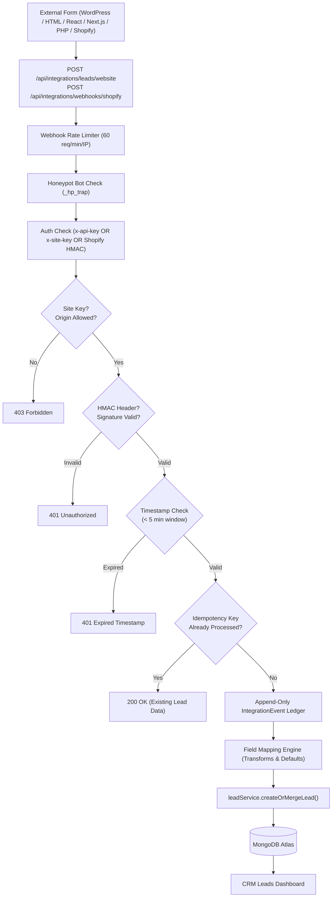

# Leads-365 CRM — Website Lead Integration System

Welcome to the **Leads-365 CRM Website Lead Integration System**. This guide provides architecture, setup instructions, security controls, and copyable production code to connect **any website or web application** to your Leads-365 CRM account.

---

## 1. Supported Integration Platforms

| Platform | Authentication / Security | Ingestion Method | Key Features |
|---|---|---|---|
| **WordPress** | Private API Key or Public Site Key | Elementor / CF7 / WPForms / PHP hook | Anti-spam, custom fields, automatic deduplication |
| **HTML / JavaScript** | Public Site Key + Allowed Origins | Browser `fetch()` + Honeypot | Zero-framework, spam-protected, rate-limited |
| **PHP** | Private API Key + HMAC-SHA256 | Server-to-server cURL / stream | Replay protection, timestamp verification, idempotency |
| **React** | Public Site Key + Allowed Origins | Reusable React component / Hook | Form validation, debouncing, loading states |
| **Next.js** | Server-side API Key (`.env.local`) | App Router Server Action / Route Handler | Zero client secret exposure, server validation |
| **Shopify** | HMAC-SHA256 Base64 Webhook Verification | Native Webhooks (`/api/integrations/webhooks/shopify`) | Order/customer capture, delivery deduplication, tenant isolation |
| **Custom Webhooks** | API Key / Bearer / HMAC-SHA256 | Standard HTTP POST JSON / Form-encoded | Zapier, Make, n8n, cURL, third-party ERPs |

---

## 2. Ingestion Flow Architecture

---

## 3. Endpoints Reference

### Public Ingestion Webhook
- **URL:** `POST /api/integrations/leads/website`
- **Headers:**
  - `Content-Type: application/json` or `application/x-www-form-urlencoded`
  - `X-API-Key: lf_live_...` (for server-to-server requests)
  - `X-Site-Key: lf_site_...` (for browser-side client forms)
  - `X-Signature-256: <hex_hmac>` (optional HMAC-SHA256 of payload)
  - `X-Timestamp: <epoch_ms>` (optional timestamp for replay protection)
  - `X-Idempotency-Key: <unique_id>` (optional unique submission UUID)

### Shopify Native Webhook
- **URL:** `POST /api/integrations/webhooks/shopify`
- **Headers:**
  - `X-Shopify-Shop-Domain: <store>.myshopify.com` (Store domain matching registered integration)
  - `X-Shopify-Hmac-Sha256: <base64_digest>` (HMAC-SHA256 digest computed with app secret)
  - `X-Shopify-Topic: <topic>` (e.g. `customers/create`, `orders/create`)
  - `X-Shopify-Webhook-Id: <uuid>` (Shopify unique delivery identifier)

### Management API (Authenticated, Multi-Tenant)
- `GET /api/integrations` — List tenant's website integrations.
- `POST /api/integrations` — Create a new integration connector.
- `POST /api/integrations/shopify/connect` — Register a Shopify store integration.
- `GET /api/integrations/shopify/status` — Get status of connected Shopify store.
- `GET /api/integrations/:id` — Retrieve integration details.
- `GET /api/integrations/:id/snippets` — Retrieve platform-specific copyable snippets.
- `POST /api/integrations/:id/test` — Send a test simulation lead.
- `PUT /api/integrations/:id` — Update field mapping, status, or settings.
- `POST /api/integrations/:id/rotate-key` — Rotate integration API key.
- `DELETE /api/integrations/:id` — Deactivate an integration.
- `GET /api/integrations/events` — View incoming lead event logs and status.
- `POST /api/integrations/events/:id/replay` — Replay a failed event submission.

---

## 4. Documentation Index

- [Shopify Webhook Integration](shopify.md)
- [WordPress Integration (Official Plugin)](wordpress.md)
  - [Download Installable Plugin ZIP](wordpress-plugin/leads365-integration.zip)
- [HTML / JavaScript Integration](html-javascript.md)
  - [Plain HTML Standalone Form Example](examples/plain-html/index.html) ([Setup Guide](examples/plain-html/README.md))
- [PHP Integration](php.md)
- [React Integration](react.md)
- [Next.js Integration](nextjs.md)
- [Custom Webhook Integration](webhooks.md)
- [Field Mapping Guide](field-mapping.md)
- [Security & Tenant Isolation](security.md)
- [Troubleshooting & FAQs](troubleshooting.md)

---

## 5. Cross-Platform Runtime Verification Status (Phase 7)

| Platform | Verification Type | Runtime Status | Verified Evidence |
|---|---|---|---|
| **React (Vite / SPA)** | Live HTTP + Browser Server | **LIVE VERIFIED** (Pass) | Real HTTP POST from `http://localhost:8088` to `/api/integrations/leads/website` returned 201 Created; Origin allowlist 403, Site Key 401, Honeypot 400 verified; Custom fields & UTM attribution persisted. |
| **Next.js (App Router)** | Server Route Handler + Live HMAC | **LIVE VERIFIED** (Pass) | Server-side HMAC-SHA256 signing, 5-min timestamp window, idempotency UUID, tenant isolation, and custom field forwarding to `lead.metadata.customFields` verified. |
| **Plain HTML / Vanilla JS** | Live Browser Origin Server | **LIVE VERIFIED** (Pass) | Browser `fetch()` submission on port 8088 verified with anti-spam honeypot, contact fields, and duplicate merging. |
| **WordPress Plugin** | ZIP Archive + Ingestion Contract | **PACKAGE & API VERIFIED** *(Local WP Server: Not Configured)* | ZIP archive integrity & structure verified (20,359 bytes); PHP CLI not installed on host Windows; No local WordPress instance on ports 80/8080 (honestly reported); Backend ingestion contract verified with WP User-Agent. |
| **Shopify Dev Store** | Synthetic HMAC Webhook Engine | **ENGINE VERIFIED** *(External Store: Not Configured)* | External dev store not configured in `.env` (honestly reported); Synthetic customer webhook with real HMAC-SHA256 calculation, topic routing, and delivery deduplication verified. |
| **CRM Invariants** | Ambient Multi-Tenant Layer | **VERIFIED** (Pass) | Tenant boundary isolation plugin actively blocked cross-tenant queries with `Cross-tenant query violation`; Zero secret leaks in client bundles. |

