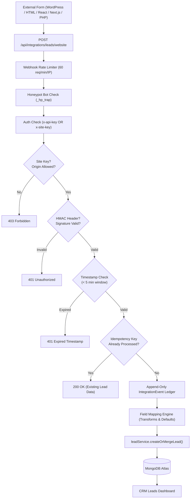

# Leads-365 CRM — Website Lead Integration System

Welcome to the **Leads-365 CRM Website Lead Integration System**. This guide provides architecture, setup instructions, security controls, and copyable production code to connect **any website or web application** to your Leads-365 CRM account.

---

## 1. Supported Integration Platforms

| Platform | Authentication / Security | Ingestion Method | Key Features |
|---|---|---|---|
| **WordPress** | Private API Key or Public Site Key | Elementor / CF7 / WPForms / PHP hook | Anti-spam, custom fields, automatic deduplication |
| **HTML / JavaScript** | Public Site Key + Allowed Origins | Browser `fetch()` + Honeypot | Zero-framework, spam-protected, rate-limited |
| **PHP** | Private API Key + HMAC-SHA256 | Server-to-server cURL / stream | Replay protection, timestamp verification, idempotency |
| **React** | Public Site Key + Allowed Origins | Reusable React component / Hook | Form validation, debouncing, loading states |
| **Next.js** | Server-side API Key (`.env.local`) | App Router Server Action / Route Handler | Zero client secret exposure, server validation |
| **Custom Webhooks** | API Key / Bearer / HMAC-SHA256 | Standard HTTP POST JSON / Form-encoded | Zapier, Make, n8n, cURL, third-party ERPs |

---

## 2. Ingestion Flow Architecture

---

## 3. Endpoints Reference

### Public Ingestion Webhook
- **URL:** `POST /api/integrations/leads/website`
- **Headers:**
  - `Content-Type: application/json` or `application/x-www-form-urlencoded`
  - `X-API-Key: lf_live_...` (for server-to-server requests)
  - `X-Site-Key: lf_site_...` (for browser-side client forms)
  - `X-Signature-256: <hex_hmac>` (optional HMAC-SHA256 of payload)
  - `X-Timestamp: <epoch_ms>` (optional timestamp for replay protection)
  - `X-Idempotency-Key: <unique_id>` (optional unique submission UUID)

### Management API (Authenticated, Multi-Tenant)
- `GET /api/integrations` — List tenant's website integrations.
- `POST /api/integrations` — Create a new integration connector.
- `GET /api/integrations/:id` — Retrieve integration details.
- `GET /api/integrations/:id/snippets` — Retrieve platform-specific copyable snippets.
- `POST /api/integrations/:id/test` — Send a test simulation lead.
- `PUT /api/integrations/:id` — Update field mapping, status, or settings.
- `POST /api/integrations/:id/rotate-key` — Rotate integration API key.
- `DELETE /api/integrations/:id` — Deactivate an integration.
- `GET /api/integrations/events` — View incoming lead event logs and status.
- `POST /api/integrations/events/:id/replay` — Replay a failed event submission.

---

## 4. Documentation Index

- [WordPress Integration](wordpress.md)
- [HTML / JavaScript Integration](html-javascript.md)
- [PHP Integration](php.md)
- [React Integration](react.md)
- [Next.js Integration](nextjs.md)
- [Custom Webhook Integration](webhooks.md)
- [Field Mapping Guide](field-mapping.md)
- [Security & Tenant Isolation](security.md)
- [Troubleshooting & FAQs](troubleshooting.md)

